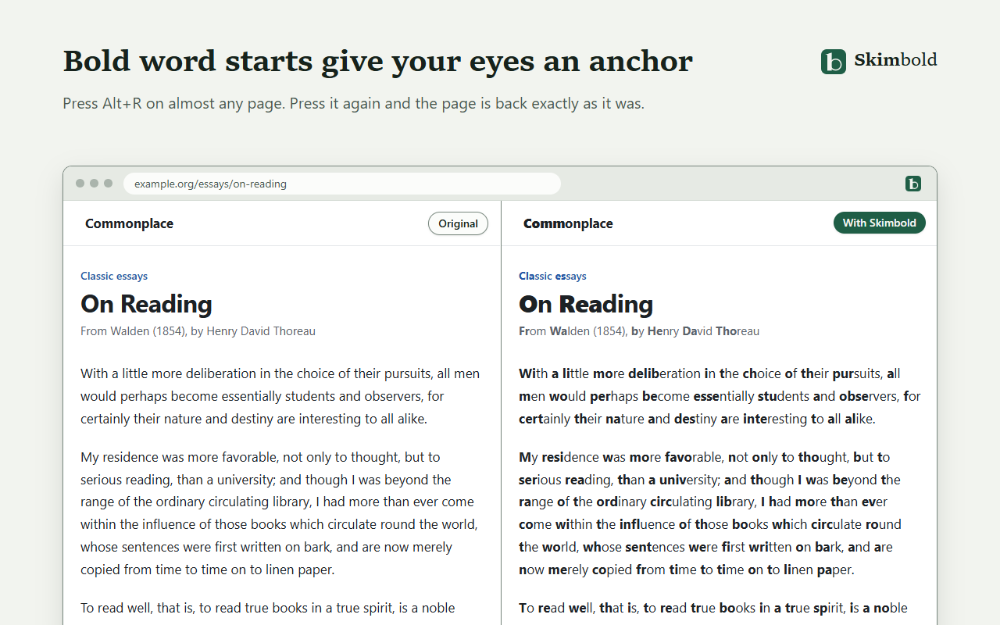

<h1> Skimbold</h1>

**Skimbold** is a free, open-source browser extension that bolds the start of every word. The heavy starts give your eyes an anchor on each line, which helps you focus, keep your place and glide through long text.

[Website](https://loveislife767.github.io/skimbold/) · [Web Reader](https://loveislife767.github.io/skimbold/reader/reader.html) · [Download](https://github.com/loveislife767/skimbold/releases/latest) · [Privacy](PRIVACY.md) · [Changelog](CHANGELOG.md)



## Features

- **Any web page, one shortcut.** Press <kbd>Alt</kbd>+<kbd>R</kbd>, or click the toolbar button. Press it again and the page goes back exactly as it was.
- **Leaves sites working.** Inputs, editors, code, terminals, math, video captions and icon fonts are left alone. It works in React and Vue apps, open shadow roots, same-origin frames, and pages with a strict Content Security Policy, and copied text pastes without the bolding.
- **Adjustable.** Choose Auto, which scales with word length, or a fixed 1, 2 or 3 letters. You can also set strength, fade for the rest of each word, and boldness, skip short words, or bold only every second or third word. Changes apply to the page straight away.
- **Always on where you want it.** Keep it on for the sites you choose, or on everywhere with a skip list. Skimbold asks for access to a site only when you turn this on.
- **Reader for PDFs and pasted text.** It opens `.pdf`, `.txt`, `.md` and `.html` files, pasted text, or a selection you send from the right-click menu. You can pick light, sepia or dark, serif or sans, and your own size and width. [It also runs on the web](https://loveislife767.github.io/skimbold/reader/reader.html), with nothing to install.
- **Private.** It collects no data, makes no network requests of its own and runs no remote code.
- **Languages.** It bolds words in Latin, Greek, Cyrillic, Armenian, Georgian and Hebrew script. Scripts that splitting would harm stay untouched: Chinese, Japanese, Korean, Arabic, Indic scripts, Thai and others.

## Install

The store listings are on their way. Until then, install from the release zip.

### Chrome, Edge, Brave and other Chromium browsers (version 122 or later)

1. Download `skimbold-<version>-chromium.zip` from the [latest release](https://github.com/loveislife767/skimbold/releases/latest). Unzip it into a folder you'll keep.
2. Open `chrome://extensions`, `edge://extensions` or `brave://extensions`.
3. Turn on **Developer mode**: top right in Chrome and Brave, left sidebar in Edge.
4. Click **Load unpacked** and choose the unzipped folder (the one containing `manifest.json`).
5. Pin Skimbold from the puzzle-piece menu so its button stays in the toolbar.

To update, unzip the new release over the same folder and click the reload arrow on Skimbold's card.

### Firefox (140 or later)

Skimbold is being submitted to addons.mozilla.org. To try it before then, open `about:debugging#/runtime/this-firefox`, click **Load Temporary Add-on** and choose `skimbold-<version>-firefox.zip` from the release. Firefox removes temporary add-ons when it restarts.

## Usage

| To | Do this |
| --- | --- |
| Turn it on or off for the page | Press <kbd>Alt</kbd>+<kbd>R</kbd>, or <kbd>Control</kbd>+<kbd>Shift</kbd>+<kbd>R</kbd> on a Mac. You can also click **Turn on for this page** in the toolbar panel, or right-click the page and choose **Toggle Skimbold on this page**. |
| Change the shortcut | `chrome://extensions/shortcuts` (Chrome and Brave), `edge://extensions/shortcuts` (Edge), or in Firefox, **about:addons** → gear menu → **Manage Extension Shortcuts**. If another extension already uses <kbd>Alt</kbd>+<kbd>R</kbd>, the panel shows a **Set a shortcut** button. |
| Adjust the look | Use the toolbar panel. Changes apply to the open page straight away. |
| Keep it on for a site | In the panel, switch on **Always on for** *site*. Your browser asks you to confirm access to that site. To turn it on everywhere with a skip list, use **Settings**. |
| Read a PDF or pasted text | Click **Reader** in the panel, or right-click the toolbar button and choose **Open Skimbold Reader**. On a PDF tab the panel offers **Open this PDF in Reader**, and the shortcut opens the PDF there directly. |
| Send a passage to the Reader | Select text, right-click and choose **Open selection in Skimbold Reader**. |

Browsers don't let extensions change their own pages (such as `chrome://` pages and the extension stores). Local files work once you turn on **Allow access to file URLs** in Skimbold's **Details** on the extensions page.

## Settings

| Setting | What it does | Default |
| --- | --- | --- |
| Bold letters | **Auto** bolds more of longer words. **1**, **2** and **3** bold a fixed number of letters. | Auto |
| Strength | Auto only. How much of each word is bold, from 1 (about a quarter) to 5 (about 60%). | 3 |
| Fade rest of word | Lightens the rest of each word by 0–60%, using the page's own text colour. | 0% |
| Boldness | Semi, Bold, Heavy or Black (font weight 600–900). | Bold |
| Skip short words | Leaves words of up to 1, 2 or 3 letters plain. | Off |
| Words to bold | Every word, every 2nd word or every 3rd word. | Every word |
| Clicking the toolbar icon | Opens the panel, or turns Skimbold on and off straight away. | Opens the panel |
| Always on | For the sites you list, or for every site except a skip list. | Off |

A word always keeps at least one plain letter, except one-letter words. With the default settings, Auto bolds:

| Word length (letters) | 1–3 | 4–6 | 7–8 | 9–11 | 12 |
| --- | --- | --- | --- | --- | --- |
| Letters in bold | 1 | 2 | 3 | 4 | 5 |

Settings are saved in your browser's extension storage and follow you to your other devices if browser sync is on. The Reader keeps its own theme, font, size and width settings.

## Privacy

Skimbold has no servers, accounts, analytics or ads. Page text is changed inside your browser and is never sent anywhere. The one network request it ever makes is the one you ask for: the Reader downloading a PDF from the tab you're on. Read the full [privacy policy](PRIVACY.md), which is also [on the website](https://loveislife767.github.io/skimbold/privacy.html).

## How it works

For each text node on the page, Skimbold inserts a `<skb-w>` wrapper right after it, holding the same text with `<skb-b>` around each word's start, and empties the original node without removing it. Because the original node stays in place as a sentinel, frameworks such as React and Vue can still update, move or remove it, and a `MutationObserver` mirrors those changes into the wrapper. Turning Skimbold off puts the text back into the original nodes and removes the wrappers, so a static page's markup is exactly what it was.

Skimbold runs only in the extension's own isolated world and changes nothing in the page's JavaScript, so the page's scripts see the page as it is: the emptied node, and the words inside the wrapper. When a script edits inside a wrapper, such as a search highlighter marking a word, that wrapper becomes the page's own content: Skimbold leaves it as the page made it, and turning Skimbold off takes the wrapper apart in place, so the highlights stay.

The algorithm itself is a pure function in [`extension/shared/core.js`](extension/shared/core.js). It is shared by the page engine, the popup preview, the Reader and the website demo.

## Known limitations

- **Bold text is wider.** Lines rewrap, and the browser's scroll anchoring keeps your reading position. A one-line label cut short with an ellipsis (…) can lose a few more characters. With **Heavy** or **Black** boldness on Windows, lines of lighter text can get a little taller, because Arial has no heavy face of its own and is drawn with Arial Black, which has taller lines.
- **Pages it can't change.** Google Docs draws text on a canvas. Closed shadow roots and cross-origin frames aren't reachable. PDFs shown in the browser's own viewer need the Reader, which needs Chromium 122 or Firefox 140 or later (on the website, a recent browser) and says so in an older one. PDFs that are only scanned images have no text to show, and the Reader tells you so.
- **Text that changes or arrives later.** Text a page re-renders many times a second, such as a chat answer being written or a live ticker, is bolded once it settles, usually within a second or two. New messages in a busy live chat are bolded within half a second. A web component that the page defines after Skimbold is on is bolded within a few seconds, or, when the page has stopped changing for about ten seconds before that, when the page next changes. A shadow root attached later to an ordinary element is bolded when the page next changes that element.
- **Pages that are still loading.** Turned on while a page is loading, Skimbold waits until it has loaded (at most until 3 seconds after the page opened) so apps rendered on the server can take over their markup first. Parts of a page that hydrate much later, such as islands loaded on scroll, may re-render once. A React app that hydrates after that reports hydration errors in the console (React errors 418, 423 and 425), draws itself afresh once, and then works normally.
- **Copying.** Copied text pastes as plain words, with headings, lists, links and emphasis kept, but not the page's own fonts and colours. Two cases are left to the browser and the page. A selection that runs from the page into a web component's shadow root pastes with its bold word starts into editors that keep formatting. A page that fills the clipboard itself from the selection (some sites add a "Read more" link to copied text) passes Skimbold's elements along without their styles, so the words paste plain.
- **Screen readers.** Some screen readers announce a split word in pieces. Skimbold is a visual aid, so turn it off while you use one.
- **Long and busy pages.** On a single page of hundreds of thousands of words, turning Skimbold on takes several seconds: about 5 seconds for 250,000 words on a fast desktop, and two or three times that on a typical laptop or a busy computer. It works in small steps, so you can keep reading meanwhile, and so does changing the letters or strength; turning it off takes about a second. On pages whose styles are costly to recompute (a long Substack article), a few frames can take 50 to 70 ms while it works, and a client-side navigation that replaces much of such a page is bolded over a second or two. While Skimbold is on, a page has about three times as many elements, so anything that restyles the whole page gets slower: opening a menu on a long Substack post goes from about 1 to 2 seconds, collapsing a thread on a long Hacker News page from about 80 to 200 ms. On news sites with hundreds of ad frames, each frame that loads is brought in line with the page, which adds a little background work.
- **Layout details.** Apps often build a line such as "Posted by Alice" from several text nodes. Inside a flex or grid container, wrapping those would change the layout, so they stay plain. The wrapper elements count as elements, so CSS like `a:last-child` or `label + input` can stop matching when a wrapper lands between two elements; any tool that wraps page text has this problem. A click on a bold word start reports the `<skb-b>` element as its target, so a page script that checks `event.target.tagName` instead of using `closest()` may not recognise the click.
- **Scripts that work on the page's text nodes.** A text node Skimbold bolds is left empty in place, with its words in the wrapper after it. Frameworks such as React and Vue replace text whole, so they aren't affected, but a page script that works on single text nodes can be:
  - A script that walks the text nodes and writes each one back, changed or not (a word or quote replacer, a switch between Latin and Cyrillic), works when it goes through them in page order in one go (a script that appends to every node can leave its additions inside bolded words). One that goes another way (backwards, or element by element, such as `querySelectorAll('p')` and then each one's child nodes), changes other nodes between its writes, pauses between nodes, or replaces each node with a new one can erase bolded words, and turning Skimbold off doesn't bring them back. Keep Skimbold off on pages with such a script.
  - `normalize()` on an element that holds bolded text removes the emptied nodes, and their words disappear until the page draws them again, also after turning Skimbold off. Search highlighters that call it as they clear their highlights (mark.js's `unmark()`, the jQuery highlight plugin's `removeHighlight()`) are recognised and keep every word, while other text the page changes at the same moment changes as usual.
  - A script that adds to a text node where it stands (`node.data += …` or `appendData()`, as in a typewriter effect) keeps only what it added: the words that were there disappear, also after turning Skimbold off. `splitText()` on such a node fails.
  - A script that searches one text node at a time doesn't find a word whose start is bold, because the bold start is a node of its own. This covers find-and-replace scripts and search highlighters in their usual setting (mark.js by default, jQuery's highlight plugin). Highlighters that search across elements, such as mark.js with `acrossElements`, do find it, and their highlights stay when you turn Skimbold off. `Range.surroundContents()` fails on a selection that starts or ends inside a bold start. When a page highlights part of bolded text and later rewrites that text, the highlight and the rest of that text are replaced too.
  - Scripts that step through child nodes (`firstChild`, `lastChild`, `childNodes`) meet the wrapper elements, so a change made to `element.lastChild` can land on a wrapper instead of the text. A script that skips empty text nodes, and elements it didn't make, sees an element whose text Skimbold bolded as empty, so it may add new text after the old instead of replacing it, and both show. YouTube's text component does this, and Skimbold recognises it there.

## Development

Requirements: Node 22.13 or later. There is no build step for development; `extension/` is the extension.

```sh
npm ci
npx playwright install chromium    # once, for the e2e tests and the image scripts
```

To try your changes, load the `extension/` folder with **Load unpacked**, then click the reload arrow on its card after each edit.

| Command | Does |
| --- | --- |
| `npm test` | Unit tests (`node:test`, no dependencies) |
| `npm run test:e2e` | End-to-end tests in headless Chromium with the extension loaded ([test/README.md](test/README.md)) |
| `npm run build` | Checks versions and network use, then writes `dist/skimbold-<ver>-chromium.zip`, `dist/skimbold-<ver>-firefox.zip`, `dist/firefox/` and `dist/site/` |
| `npm run lint:firefox` | `web-ext lint` on `dist/firefox/` (run the build first) |
| `npm run check:network` | Fails on network APIs, remote loads, `eval` or banned wording in our code |
| `npm run icons` | Renders the PNG icons from `extension/icons/icon.svg` |
| `npm run store-assets` | Renders the store screenshots and promo tiles from the real extension |
| `npm run vendor:pdfjs` | Copies the unmodified pdf.js build from `node_modules` into `extension/vendor/pdfjs/` |

```
extension/          the extension (load this folder unpacked)
  manifest.json     Chromium manifest; the build derives the Firefox one
  background.js     toggling, badge, menus, shortcut, always-on registration
  shared/           core.js (the algorithm), settings.js, theme.css (design tokens)
  content/          engine.js (page engine), auto.js (always-on entry)
  popup/ options/   toolbar panel and settings page
  reader/           the Reader, also published on the website
  vendor/pdfjs/     pdf.js 6.3.289, unmodified
site/               GitHub Pages: landing page, privacy policy, 404
scripts/            build, zip writer, network check, icon and store-asset renderers
store/              store listings, screenshots, promo tiles, submission guide
test/               unit tests, e2e tests and fixtures
docs/               design spec and brand guide
```

GitHub Actions runs the unit tests, the build, the Firefox lint and the e2e tests on every push ([ci.yml](.github/workflows/ci.yml)). Every push to `main` also publishes `dist/site/` to GitHub Pages ([pages.yml](.github/workflows/pages.yml)).

To release, set the same version in `package.json` and `extension/manifest.json`, add it to [CHANGELOG.md](CHANGELOG.md), run `npm run build`, and attach both zips to a GitHub release. [store/SUBMITTING.md](store/SUBMITTING.md) covers the stores.

## Contributing

Bug reports and pull requests are welcome. See [CONTRIBUTING.md](CONTRIBUTING.md).

## Credits

- PDF text extraction uses [pdf.js](https://github.com/mozilla/pdf.js) by Mozilla, version 6.3.289, included unmodified under the [Apache License 2.0](extension/vendor/pdfjs/LICENSE).
- The sample text in the demo and screenshots comes from Henry David Thoreau's *Walden* (1854), which is in the public domain.

## License

[MIT](LICENSE) © 2026 Simon Buhl
